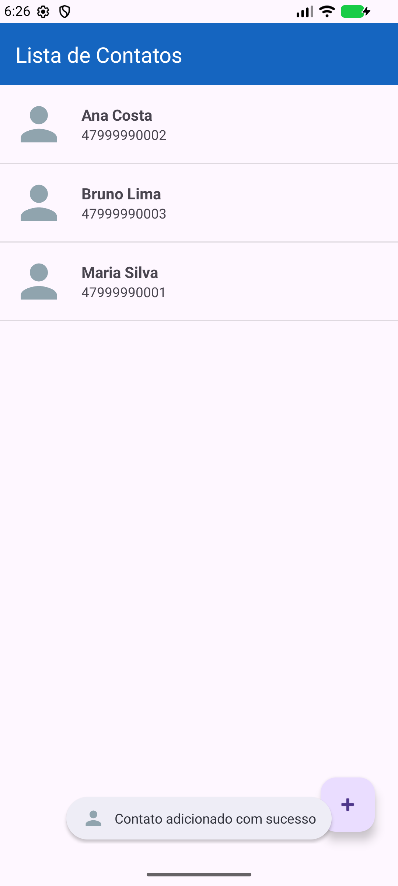
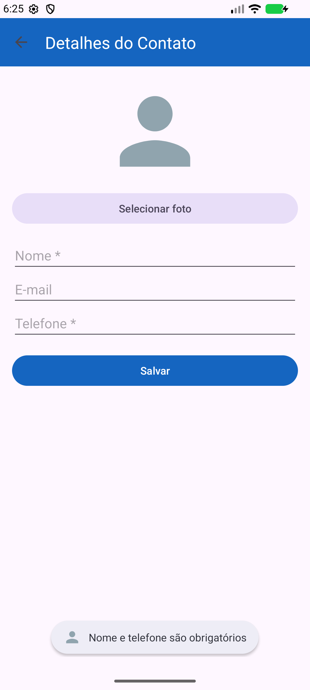
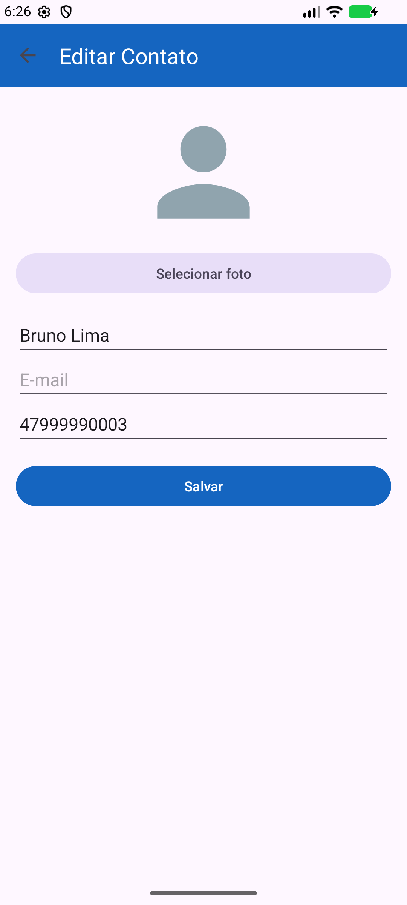
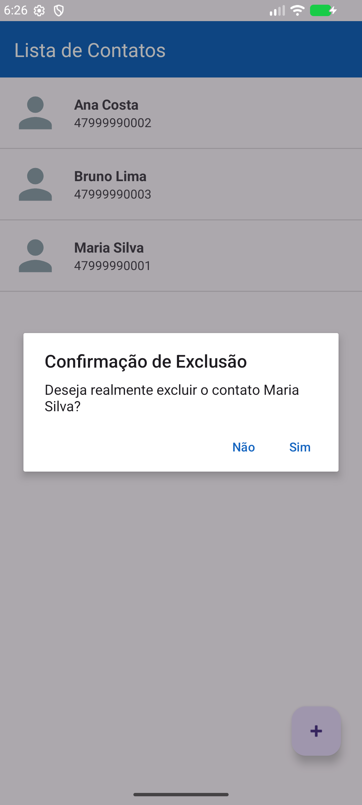

# AD3 — Agenda de Contatos com SQLite (Android, Java, MVC)

Programação para Dispositivos Móveis (STC0328) — IFC Camboriú — Jhonn L. S. Gonçalves

Implementação do projeto "Sistema de Gerenciamento de Contatos" da Unidade 3: CRUD completo de contatos (nome, e-mail, telefone e foto) persistido em banco **SQLite**, organizado em **MVC**.

## Estrutura

| Camada | Classes |
|---|---|
| Model | `model/Contato.java` (entidade), `model/ContatoDAO.java` (CRUD em SQL parametrizado), `model/DatabaseHelper.java` (criação e migração do banco, `SQLiteOpenHelper`) |
| Controller | `controller/ContatoController.java` (intermedia View e Model, valida nome e telefone obrigatórios) |
| View | `MainActivity.java` + `activity_main.xml` + `list_item.xml` (lista), `AdicionarContatoActivity.java` + `activity_adicionar_contato.xml` (formulário de inclusão e alteração) |

## Funcionamento

- **Create:** botão flutuante **+** → formulário vazio → Salvar.
- **Read:** a lista é carregada do banco, em ordem alfabética, e recarregada no `onResume()`.
- **Update:** toque curto num contato → formulário preenchido ("Editar Contato") → Salvar.
- **Delete:** toque longo num contato → diálogo de confirmação → Sim.
- **Foto:** botão "Selecionar foto" (seletor de arquivos do sistema); a URI da imagem é gravada na coluna `foto`.

## Ajustes em relação ao código do material

1. `Contato` ganhou o construtor com `id`, que o `ContatoController.atualizarContato()` usa mas o material não declara.
2. A ordem dos parâmetros de `new Contato(nome, email, telefone, foto)` foi alinhada com o construtor (no material, e-mail e telefone ficavam trocados).
3. Na validação, o `return` impede salvar sem nome ou telefone (no material o aviso aparecia, mas o contato era salvo mesmo assim).
4. A alteração (Update) foi implementada na `AdicionarContatoActivity`, que recebe o contato pela `Intent`.
5. `onUpgrade()` só faz o `ALTER TABLE`; o material também apagava a tabela, perdendo os contatos a cada migração.
6. A `ImageView` do formulário é `R.id.imageView` (o material buscava `R.id.imageView2`, que é a da lista).
7. Um único `ContatoController` por tela, fechado no `onDestroy()`, e cursores fechados com *try-with-resources*.

## Testes (emulador Android 16, API 36)

| Teste | Resultado |
|---|---|
| Salvar com campos vazios | Permanece no formulário com o aviso "Nome e telefone são obrigatórios" |
| Inserir 3 contatos | Aparecem na lista em ordem alfabética |
| Editar o e-mail de um contato | O valor novo aparece ao reabrir o contato |
| Excluir com toque longo + "Sim" | O contato some da lista, aviso "Contato excluído" |

| Lista | Validação | Edição | Exclusão |
|---|---|---|---|
|  |  |  |  |

## Como rodar

Abrir a pasta no Android Studio e executar o módulo `app` (minSdk 24, compileSdk 36, Java 17).
